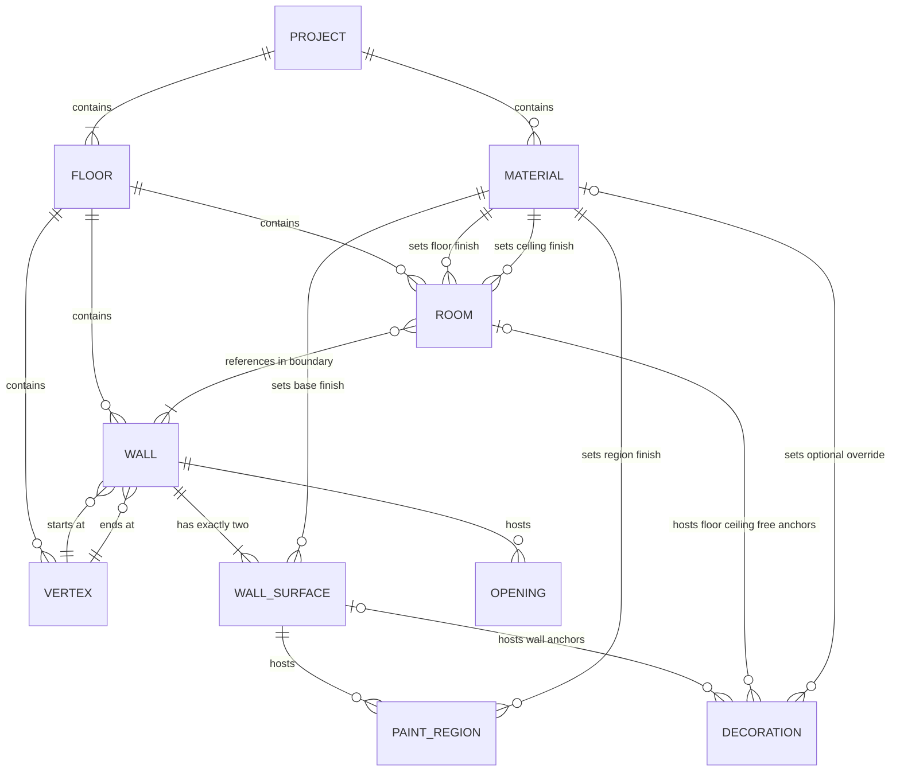
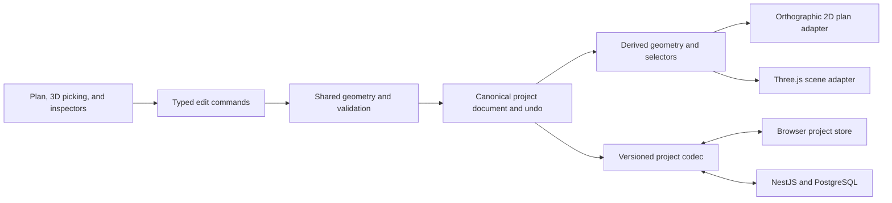

# Feature 01 Architecture Audit and Foundation

Room Paint Studio can support a connected floor plan without replacing the React editor, Three.js preview, or project API. The main change is to give geometry a shared source of truth. A floor owns a graph of vertices and physical walls, rooms reference closed paths through that graph, and paint and wall-mounted objects reference stable wall faces. Both viewports consume geometry derived from that graph. The current rectangular editor remains the compatibility path while those foundations are introduced.

This audit covers repository revision `25c2725`. The models, contracts, and rollout below are proposals. The deliverable is this report.

## Existing architecture

| Area | Current implementation and limits |
| --- | --- |
| Folder structure | `apps/web/app` contains the Next.js entry point and styles. `apps/web/src/components` contains shared controls and dialogs. `apps/web/src/editor` contains the editor, feature panels, and Three.js scene. `apps/web/src/projects` contains account, project library, and browser/API adapters. `apps/api/src` contains NestJS auth, project routes, TypeORM entities, and migrations. `packages/studio` contains TypeScript models, catalogs, placement constraints, and enum constants shared by both apps. [Entry point](../../apps/web/app/page.tsx#L1) · [Project structure](../../README.md#project-structure) |
| Room and wall model | `Project` holds an ordered `rooms[]` list. A room has an ID, name, rectangular length/width/height, four paint records keyed by `north/east/south/west`, daylight, openings, furniture, lights, paint options, and optional ceiling finishes and decor. A `Wall` is a compass-side enum. Walls have no individual geometry, ID, thickness, height, or shared boundary in saved data. The scene uses a fixed thickness of `0.16 m`. The current project supports up to 30 rooms, each edited separately. The custom room preset accepts three dimensions. [Shared model](../../packages/studio/model.ts#L6) · [Room creation and resize](../../apps/web/src/editor/rooms.ts#L9) · [Wall templates](../../apps/web/src/editor/scene/architecture.ts#L11) |
| 2D and 3D | One `Preview` mounts one imperative `RoomScene` for the active room. It uses an orthographic camera for exterior, top, and ceiling views and a perspective camera for Interior. Top view is the same WebGL scene viewed from above, with wall groups compressed vertically and swing guides as needed. It has no independent plan geometry, drafting tools, floor-wide canvas, or 2D rendering fallback. The mesh factories build rectangular slabs and segment a wall into solid strips around opening rectangles. Picking uses raycasts plus `userData.hit`. [React bridge](../../apps/web/src/editor/scene/preview.tsx#L31) · [Cameras and framing](../../apps/web/src/editor/scene/room-scene.ts#L165) · [Top view](../../apps/web/src/editor/scene/room-scene.ts#L440) · [Picking](../../apps/web/src/editor/scene/room-scene.ts#L510) |
| Coordinates and units | Every room uses the same local origin at its floor center. Length is on X, width on Z, and Y points up. North is −Z, east is +X. Dimensions, positions, opening sizes, sill heights, and signed offsets are in meters. Opening offset is from the wall midpoint along model-local +X, which corresponds to east, south, west, and north on the four respective walls. Orientation and swing values are stored in degrees and converted to radians in the scene. Some fitting rules round to millimeters and layout checks often allow 2 mm of drift. The dimensions form accepts arbitrary decimal precision. [Dimensions UI](../../apps/web/src/editor/room-dialog.tsx#L44) · [Placement rules](../../packages/studio/model.ts#L81) · [Wall orientation](../../apps/web/src/editor/scene/architecture.ts#L11) · [Opening transforms](../../apps/web/src/editor/scene/room-scene.ts#L590) |
| State and editing | `Editor` owns `useProjectHistory`, a React reducer with structurally shared project snapshots and up to 60 past entries. Timed inspector edits and drag-start room references group updates. Active room, selected wall/object, view, tools, dialogs, and save/account metadata live in component state. The scene feeds back whole room replacements during drags and the editor maps over the room array to apply them. Browser and API adapters serialize the document on manual save. [Editor state](../../apps/web/src/editor/editor.tsx#L66) · [Edit pipeline](../../apps/web/src/editor/editor.tsx#L153) · [History](../../apps/web/src/editor/history.ts#L4) |
| Painting | The inspector applies a HEX color and Matte, Eggshell, or Satin finish to a single enum wall or all four walls. Compare captures the four paint values, renders the current room with either paint set, and applies a saved set as a replacement. The scene assigns one material to the wall solids on both sides. Wall trim and opening assemblies use separate materials. There is no geometry for a paint region and no face-specific finish. [Paint controls](../../apps/web/src/editor/paint/panel.tsx#L23) · [Comparison](../../apps/web/src/editor/paint/compare.tsx#L11) · [Wall material](../../apps/web/src/editor/scene/architecture.ts#L176) |
| Materials and textures | A wall's finish maps to roughness `0.98 / 0.65 / 0.33`. Ceiling finishes store a preset name. Furniture and ceiling decor can store color overrides. Three.js materials live in scene factories. Procedural Canvas textures supply the floor, rugs, artwork, window backdrop, and some ceiling patterns. `SceneAssets` shares some resources within a scene. Ceiling 3D panels already use instancing. There are no persistent material IDs, reusable user-defined materials, or project texture assets. [Wall finishes](../../apps/web/src/editor/scene/architecture.ts#L11) · [Scene assets](../../apps/web/src/editor/scene/furniture.ts#L12) · [Textures](../../apps/web/src/editor/scene/textures.ts#L10) · [Ceiling finishes](../../apps/web/src/editor/scene/ceiling-finish.ts#L7) |
| Persistence | Signed-out projects are stored as a single JSON array in browser `localStorage` under `room-paint-studio.projects.v1`. The last-open pointer stores the backend and project ID. Local reading checks the envelope superficially. Account projects have UUID v4 IDs, ownership, a name, timestamps, a `rooms` JSONB array, and an optimistic-lock `version`. The REST API validates nested fields and layout and rejects unknown fields. The update checks ownership and version in one statement and returns HTTP 409 on stale edits. The project list counts rooms with `jsonb_array_length`. Both stores currently persist the entire project on save. There is no document `schemaVersion`, file import, or file export. [Browser storage](../../apps/web/src/projects/local.ts#L3) · [API DTOs](../../apps/api/src/projects/project.dto.ts#L104) · [API and conflict behavior](../../apps/api/src/projects/projects.ts#L58) · [Database entity](../../apps/api/src/database/entities.ts#L25) · [Request limits](../../apps/api/src/main.ts#L22) |

### Reuse and coupling

- Keep the React shell, shared form controls, project dialogs, room navigation, paint palette and swatches, and furniture, lighting, and ceiling catalogs. Keep the `Preview` lifecycle, camera controls, procedural model factories, swing helpers, and explicit resource disposal. The comparison dialog already exercises `Preview` as a read-only consumer. [Controls](../../apps/web/src/components/ui.tsx) · [Preview lifecycle](../../apps/web/src/editor/scene/preview.tsx#L31) · [Comparison consumers](../../apps/web/src/editor/paint/compare.tsx#L36)
- Put the new domain, geometry, revision codecs, and edit rules under `packages/studio`, free of React, DOM, Three.js, and NestJS types. Keep legacy fitting functions available to the v1 adapter. Placement today assumes a centered rectangle in the shared rules and scene, and panels pass whole room records around. Move those responsibilities behind typed queries and edit commands as each tool changes. [Placement rules](../../packages/studio/model.ts#L84) · [Fixture placement](../../apps/web/src/editor/scene/fixture-placement.ts#L7) · [Opening controls](../../apps/web/src/editor/objects.tsx#L50)
- Reuse NestJS ownership and optimistic locking while moving geometry and reference validation into the shared domain. Adapt DTOs, client serializers, the JSONB mapping, and room count together. Adding fields to the current web payload alone would fail server validation. [Client serialization](../../apps/web/src/projects/api.ts#L31) · [Validation pipe](../../apps/api/src/main.ts#L38) · [Project service](../../apps/api/src/projects/projects.ts#L66)

### Performance risks

These hotspots come from the code paths. Their impact needs browser measurements before floor-wide rendering ships.

| Path | Existing behavior and scaling risk | Proposed measurement and response |
| --- | --- | --- |
| Drag and document updates | Each qualifying pointer move builds a replacement room, maps project rooms, and dispatches an edit. Dirty detection stringifies both documents when a saved baseline exists. The `Preview` layout effect calls into the scene on each React render. | Record pointer-to-frame latency and React commits during wall and opening drags. Keep drafts out of undo history and dirty checking, update drafts at animation-frame cadence, and commit a single document edit per gesture. |
| Geometry, meshes, and picking | A dimension change rebuilds floor and ceiling geometry and the floor texture. Wall construction filters openings across its cut intervals and creates separate solid and trim meshes. Moving an opening can rebuild its wall on each accepted update. Picking recursively traverses the room group, and a selected object is traversed for bounds each rendered frame. | Measure wall rebuild time, draw calls, triangles, and pick time. Invalidate by wall, affected junction, and dependent room. Use pick proxies or a spatial index when measured, and batch wall geometry by material where picking and per-face edits permit it. |
| GPU and texture work | Rendering is already demand-driven. Pixel ratio is capped at 1.75, and shadows refresh on invalidation or swings. Each preview owns a renderer, procedural textures, and a daylight rig with a 2048×2048 shadow map. A populated comparison can mount two more previews alongside the main one. | Measure GPU resource counts, texture allocation, and shadow-pass times with comparison open and after repeated room switches. Cache geometry and assets with explicit ownership and disposal. Preserve demand rendering and use lighter comparison previews if needed. |
| Storage and history | Browser saves synchronously serialize and rewrite the entire library. Account saves replace a full JSONB array and face a 2 MB JSON request cap. History retains old object graphs through structural sharing. | Track serialized bytes, save time, and retained heap on large documents. Set tested per-document and per-entity limits. Write browser projects individually and retain bounded history. |

Capture a baseline for the starter room, a dense room at current limits, a populated paint comparison, and a synthetic multi-room floor as soon as the new adapters exist. Use the same viewport size and hardware for comparisons and record median and p95 interaction times. [Editor dirty check](../../apps/web/src/editor/editor.tsx#L90) · [Scene update and rendering](../../apps/web/src/editor/scene/room-scene.ts#L261) · [Recursive picking](../../apps/web/src/editor/scene/room-scene.ts#L510) · [Daylight shadow](../../apps/web/src/editor/scene/lighting.ts#L14)

## Proposed domain model

Store one JSON document aggregate per project. `Project` is its root record. The document contains normalized collections of the entities below, keyed by ID in memory. Serialize them as arrays in stable ID order for validation and deterministic exports. Keep user-visible floor and room order in explicit `order` fields and preserve the sequence of oriented edges in each room boundary.

| Entity | Proposed fields and responsibilities |
| --- | --- |
| **Project** | `id`, `name`, `displayUnit`. Owns the document's floors and material library. Owns the storage boundary for undo, save, and export. Persistence metadata such as `revision` and `updatedAt` belongs to the saved envelope. |
| **Floor** | `id`, `name`, `order`, `elevationM`. Defines a horizontal plane in project space. A floor may contain disconnected rooms and can temporarily be empty. |
| **Room** | `id`, `floorId`, `name`, `order`, `boundary: { wallId, direction }[]`, `ceilingHeightM`, `floorMaterialId`, `ceilingMaterialId`, `daylight`, `paintOptions`. The ordered wall references form a closed ring. The polygon, wall lengths, and area are derived data. Preserve daylight and comparison options as room settings. |
| **Vertex** | `id`, `floorId`, `xM`, `zM`. Represents a shared endpoint on a floor. Multiple walls can meet at this endpoint. |
| **Wall** | `id`, `floorId`, `startVertexId`, `endVertexId`, `positiveOffsetM`, `negativeOffsetM`, `heightM`, optional `label`. The endpoints define a directed reference line. Offsets are nonnegative and their sum is the physical thickness. Keep one record for a shared physical wall. |
| **WallSurface** | `id`, `wallId`, `side: positive / negative`, `baseMaterialId`. Each wall has exactly one face per side. A face can bound at most one room. Derive the adjacent room and normal from topology. Use the face ID for paint, selection, and wall mounts. End caps and opening reveals use renderer assembly defaults. |
| **Opening** | `id`, `wallId`, `kind`, `centerUM`, `sillM`, `widthM`, `heightM`, and kind-specific `settings`. Doors store `hingeEnd`, `swingSide`, and `openAngleDeg`. Windows store sash angle and optional curtains with their mounting side. One opening cuts the wall once and is visible from both faces. |
| **PaintRegion** | `id`, `surfaceId`, `materialId`, `polygonUV: { uM, vM }[]`, `order`. A closed simple polygon in wall-face coordinates. Rectangular stripes and accent shapes use the same representation. Paint in ascending order so the higher layer wins at overlaps, with unique order within each face. Clip the rendered paint to the usable face and subtract openings while storing the authored polygon. |
| **Decoration** | `id`, `assetKey`, `assetVersion`, `category`, `anchor`, `rotationDeg`, `scale`, optional `materialId`, and category-specific `settings`. Covers furniture, ceiling decor, fixtures, and future wall decor. Anchors are `floor/ceiling { roomId, xM, zM }`, `free { roomId, xM, yM, zM }`, or `wall { surfaceId, uM, vM, depthM }`. A wall anchor resolves its room from the face. Retain typed fixture, screen, and cabinet settings. Anchor frames determine how placements follow a changed host. |
| **Material** | `id`, optional `name`, `baseColorHex`, `roughness`, `metalness`, optional `paintFinish`, and optional texture references by slot with `assetKey`, `assetVersion`, and physical repeat size in meters. Retain a project-owned material definition for reproducible appearance. Treat definitions as immutable and rebind selected targets on paint edits. |

In the diagram, relationships labeled “contains” or “has” are ownership. Arrow direction on references does not imply storage in both entities.

Each closed room boundary needs at least three edges. A wall can have zero to two adjacent rooms, with at most one per side. Decorations have exactly one anchor kind. A `Room.paintOptions` entry keeps its own ID, name, and a snapshot of base materials and optional region definitions keyed by surface ID. Snapshot regions have option-scoped identities. Applying an option is one command. It restores paint on available surfaces and reports missing targets. Retain materials referenced by saved options and retained undo entries.

### Identity and topology rules

- Keep the existing project UUID v4. Use opaque, entity-typed IDs in TypeScript and plain strings in JSON. New entities get UUID v4 IDs on creation. Legacy conversion preserves room IDs and generates deterministic UUIDs for new topology and remapped children. IDs are stable within a project and independent of coordinates, names, array order, or material choices. Cross-document references carry both project ID and entity ID. A project copy gets a new project ID and can reuse internal IDs. Duplicating entities inside a project allocates new IDs and remaps references.
- Support straight wall segments and simple concave or convex room rings first. Validate finite values, existing same-floor endpoints, nonzero lengths, valid thickness/height, a closed ring without self-intersections, and non-overlapping room interiors. Adjacent rooms reuse the same wall in opposite directions. At a T-junction, split the intersected wall at the shared vertex. Store an unclosed boundary only as an editing draft. Curves and interior room holes would need additional geometry contracts.
- Edits to a wall or a shared vertex update every incident boundary in one transaction. Both wall faces have independent finishes and mounts. An enclosing wall must reach the taller adjacent room ceiling. Calculate finished room footprints from the room-side offsets and resolved joins. Reject inverted, degenerate, or overlapping footprints. Use one join implementation for the plan, meshes, and placement rules.
- Validate that opening rectangles fit between the wall's resolved end joins, stay within its height, and leave the required clearance from other openings. A door sill remains at floor level. Validate each paint region's polygon and material reference. When openings move, recompute the visible region without changing its saved coordinates. Reject topology edits that would remove all usable face area from an attached region unless the edit resolves it explicitly.
- Wall endpoint edits keep wall and face IDs. Opening, region, and wall-mounted object coordinates stay in meters from the directed start. Validate host fit on commit and reject changes that would strand openings or mounts unless the same command explicitly repositions or removes them. Split commands retain the IDs of the start segment and its faces, allocate IDs for the new segment, rewrite room edges, and rebase hosted coordinates. A region crossing the split is partitioned with new IDs for additional pieces. An opening spanning the split requires a different split or explicit relocation. Apply the same remapping to paint options in the transaction. Removal and merge commands must resolve dependencies before committing. Undo restores the exact former IDs and links.

## Coordinate and measurement contract

Use a right-handed project frame with +X east, +Y up, +Z south, and meters as the canonical distance unit. Floor vertices store project X/Z and derive Y from `floor.elevationM`. A room floor anchor is at that elevation. A ceiling anchor adds `room.ceilingHeightM`. Free anchor X/Z values use project axes and its Y is height above the owning floor. North-up in plan maps screen-right to +X and screen-down to +Z. Zoom, pan, and pixels per meter belong to the viewport.

For a wall from A to B, let `T = normalize(B − A)` and `N = T × (0, 1, 0)`. Positive is the side toward `N`. Both faces use U in meters from A toward B and V in meters above the floor. A face point is `A + T·u + up·v + N·signedOffset`, where signed offset is `positiveOffsetM` or `−negativeOffsetM`. A positive decoration depth extends away from its face along the outward face normal toward the adjacent room or exterior. Opening cuts use the same U/V frame through the thickness. The boundary ring has positive signed area in `(x, z)`, which reads clockwise on the north-up screen. A forward edge then uses the positive wall face and a reverse edge uses the negative face. Wall direction stays stable during ordinary edits, including room selection and camera changes.

Persist finite double-precision meters and degrees. Keep area in square meters, light output in lumens where explicitly specified, color temperature in kelvin, and percentages and scale as dimensionless values. Use explicit unit suffixes in the schema. Preserve full legacy precision on load, snap new edits to the configured grid, and format separately for display. A 1 mm default edit increment is a starting choice. Keep snapping and display rounding independent of geometry predicates. Centralize numeric tolerances and distinguish floating-point epsilon from the existing 2 mm placement allowance, which belongs to legacy compatibility. Convert to radians and Three.js vectors at the render boundary.

## State and rendering strategy

Keep React's reducer as the editing boundary. Replace generic room mutation callbacks with typed commands such as `MoveVertex`, `SetSurfaceMaterial`, and `PlaceDecoration`. Commands validate against the latest committed document, apply related changes as one transaction, and publish affected IDs. Reuse structural sharing and bounded undo. A drag uses a transient draft until pointer-up, discards the draft on cancellation, and creates a single undo entry on commit. Keep view, selection, active floor/room, tool, and draft outside the serialized document. Reconcile selections by ID after edit, undo, redo, or load. Use document identity or a canonical content fingerprint for dirty checks and compare save results against the snapshot actually submitted.

Derive a geometry projection from topology for wall joins, clear room polygons, opening cutouts, room bounds, and surface transforms. Use it for hit-testing and validation in both views. Start the dedicated 2D plan adapter with SVG for crisp geometry, labels, and editable handles. The existing Three.js Top view can remain available during rollout. In 3D, key wall assemblies and their distinct faces by ID, and update only affected wall, slab, material, or object resources. Retain the existing preview and selection UI, translating renderer hits into domain entity IDs.

Resolve paint regions to surface patches in UV space. Clip patches to finished face bounds and opening holes, then tessellate non-overlapping visible areas in layer order to avoid depth fighting. A change to paint color or finish should update an affected material binding without regenerating the physical wall. For decorations, derive world transforms from the appropriate anchor, test the footprint against the room polygon or face, and reuse the current catalog builders. Keep intentional furniture overlap supported. Cache geometry and resource lookups outside the document. Serialize catalog and texture keys with versions, leaving GPU objects and procedural bitmap generation to the scene adapter.

## Backward compatibility and migration

### Format and rollout

1. Define `schemaVersion: 2` on the serialized envelope with a nested `document`. Treat the current unversioned `rooms[]` representation as v1. Keep the storage `revision` independent of schema version and map it from the current API `version`. Validate JSON shape, entity limits, and domain invariants on read/write. Preserve unsupported newer documents for recovery and surface a version error.
2. Add an optional versioned document JSONB column alongside the existing `rooms` column. Deploy the new server reader and v2 API contract before enabling v2 writes. The v2 API reads either representation and returns a normalized document. A v1 client can still read and edit v1 rows. Keep project summaries, ownership, timestamps, idempotent create, and conflict handling. Compute room counts from the active representation. Use an empty `rooms` array for newly created v2 rows to satisfy the existing `NOT NULL` and array constraints, and verify the Next.js API rewrite for both routes.
3. Read v1 projects in memory without changing storage or marking the project dirty. Promote a project only on explicit save through the v2 client. Update document and optimistic revision atomically in PostgreSQL and preserve the prior v1 payload for recovery. After a row is promoted, prevent the v1 endpoints from editing it and return an actionable upgrade response for a v1 open. Keep ordinary v1 writes enabled for remaining v1 rows. Rollback disables v2 writes and keeps a release capable of reading v2 documents. A conversion back to v1 requires an exact representability check when offered. Shared walls and paint regions generally cannot be represented in v1.
4. Use an IndexedDB store keyed by project ID for v2 browser documents, with transactional writes and revision checks. Read the old localStorage array and last-open pointer as fallback and keep the original records for recovery. Prefer a committed v2 record when both stores contain the ID. Record deletes in the v2 store so an older browser record cannot reappear as a fallback. Preserve the saved payload and last-open behavior across a refresh, failed write, or quota error. Report malformed records separately with a recovery path that preserves their raw data. Existing browser project IDs that fail the v1 account UUID contract can receive a valid new ID on explicit account copy while retaining internal references.
5. Reuse the v2 codec for JSON file import and export. Include the project ID, name, document schema version, and material and catalog references. Omit account/session metadata and transient editor state. Treat a file import as a new copy by default and validate references, numeric values, geometry complexity, and size before import. Initially support bundled, versioned assets. A later format for user-supplied textures needs an asset manifest and packaging or a durable asset store.

### Mapping legacy projects

| Source | Deterministic conversion |
| --- | --- |
| Project and room layout | Keep the project ID, names, room IDs, and ordering. Create a synthesized floor at elevation zero. Place the first room around its legacy origin. Place subsequent rooms left-to-right along +X in saved order with a documented gap of at least 1 m between outer bounds. The v1 format stores no relative placement. Preserve the original array order and retain room-centered camera framing so the layout assumption only affects the new floor-wide view. |
| Rectangle and walls | Use translated vertices NW, NE, SE, SW at legacy half-length and half-width corners. Create four forward walls named for the legacy sides. Set `positiveOffsetM = 0`, `negativeOffsetM = 0.16`, and both room ceiling and wall height to legacy height. This keeps the interior wall faces at the original dimension lines. Model old corner extensions, trim, slab edges, and camera cutaways in the compatibility adapter until new assemblies meet the parity gate. |
| Paint and finishes | Convert each wall color/finish into a material with its legacy roughness. Bind the material to both faces, matching the single material previously used for all wall solids. Convert comparison options to surface-keyed snapshots for both faces. Start without paint regions. Map the existing floor texture and ceiling presets to versioned built-in materials, with a material or asset recipe for ceiling finishes that use geometry. Preserve per-room daylight. |
| Doors and windows | Resolve each side to its wall ID. Set `centerUM = spanM / 2 + legacy.offset`, retaining the sign on all four sides because the wall direction matches the legacy local +X. Preserve width, height, sill, angle, curtains and draw values. Convert a door's omitted/Left hinge to the start end and Right to the end, with swing toward the positive face. Place legacy curtains on the positive face. Verify both swing directions against the current renderer. |
| Furniture and ceiling decor | Translate X/Z by the assigned room center. Retain catalog kind, angle, scale, color, display settings, and cabinet door angle. Use floor or ceiling anchors as appropriate and preserve catalog defaults for absent values. Legacy `Wall art` is a furniture item whose height is model-derived. Keep that behavior via its legacy floor anchor and catalog model instead of inferring a host wall. |
| Fixtures | Convert wall mounts to the room-facing surface and project legacy X/Z onto U. Preserve vertical placement as V, and keep floor, ceiling, and free-mounted placements. Treat absent mount as `Free` and absent `enabled` as enabled. Keep legacy `brightness` as a distinct intensity input when `lumens` is absent, and preserve the renderer's `brightness × 0.39` intensity calculation. The existing display conversion and Three.js power assignment are different code paths. Retain warmth, direction, and tilt with the original fixture orientation basis. |
| Legacy IDs and defaults | Derive UUIDs with a fixed namespace and an unambiguous tuple of project ID, room ID, entity kind, and legacy role or child ID. V1 checks child ID uniqueness per collection per room, so a bare child ID cannot key a project-wide map. Keep existing room IDs and resolve new IDs once in the saved v2 document. Freeze explicit default mappings against the legacy catalogs. Preserve accepted legacy decimal values and the source payload without silently making invalid local records fit. |

Migration gates should cover deterministic conversion and v2 round-trips from real-format browser and API fixtures, repeated load/save, duplicate child IDs across rooms, custom dimensions, asymmetric offsets on all wall sides, both hinge sides, curtains, all light mount kinds and legacy intensity variants, furniture defaults, ceiling variants, and comparison options. Include legacy browser records rejected by strict server validation, corrupt data, unknown schema versions, browser quota failures, server conflicts, and an older client attempting to edit a promoted row. Compare legacy and converted renderings and interactions on the same room and camera. [Legacy IDs and validation](../../apps/api/src/projects/projects.ts#L12) · [Opening geometry](../../apps/web/src/editor/scene/architecture.ts#L108) · [Wall art placement](../../apps/web/src/editor/scene/furniture.ts#L115) · [Fixture intensity](../../apps/web/src/editor/scene/lighting.ts#L180)

## Implementation roadmap

| Sequence | Work and dependencies | Exit criteria |
| --- | --- | --- |
| 1. Domain and compatibility | Define shared entity types and codecs, the unit and ID policy, legacy conversion, and versioned asset keys. Use the current editor and renderer as the parity reference. | Valid v1 fixtures map deterministically. Both adapters resolve the same document. The rectangular workflow and legacy save behavior pass parity checks. |
| 2. Persistence and editing boundary | Depends on 1. Add shared document validation, server dual-read and versioned API, browser document store, and command-driven reducer. Adapt existing controls through rectangular selectors. | Browser and account saves round-trip without losing data. Revision conflicts, failed saves, promotion, and rollback are exercised. A multi-entity edit creates one undo entry. |
| 3. Geometry and floor plan | Depends on 1 and the commands from 2. Build vertex/wall topology, snapping, joins, polygon validation and triangulation, shared wall semantics, and stable hit IDs. Connect a dedicated plan viewport and the existing 3D adapter. | A concave room and adjacent rooms render consistently in 2D and 3D. Independent wall edits, shared vertex moves, opening drag, and undo preserve valid topology. |
| 4. Paint regions and materials | Depends on 3 for surface frames, robust polygon clipping, and opening cutouts. Extend surface selection, rendering, and comparison snapshots. | Two sides of a shared wall can carry different paint. Region order and opening holes render consistently. Save, reload, compare, and undo retain the intended finish. |
| 5. Decoration and portable projects | Depends on 2 and 3. Add geometry-aware decoration anchors and fixture placement. Complete file import/export using the v2 codec and catalog/asset contracts. Gate release on performance baselines and migration coverage. | Existing and new mounted items keep placement across tools and reloads, and exported projects round-trip with all references resolved. |

Start with the installed React, Three.js, NestJS, and PostgreSQL stack. Choose a triangulation and polygon clipping implementation only after validating concave rings, near-collinear points, opening holes, and performance with representative fixtures. Keep any library behind the shared geometry boundary. User-supplied assets, curved walls, and complex room rings are separate design decisions.

## Verification

`npm run typecheck` and `npm run build` passed for the current application. The four legacy wall directions were cross-checked with the installed Three.js rotation math. Performance observations are based on source inspection. Browser profiling, production data migration, and compatibility testing of the proposed format are implementation gates.

## Acceptance checklist

- [x] Existing architecture documented against repository sources.
- [x] Current limitations and performance risks identified.
- [x] All ten proposed entities and their stable IDs defined.
- [x] Entity ownership, relationships, and edit invariants diagrammed.
- [x] Project, floor, wall, and viewport coordinate conventions specified.
- [x] Canonical units, input snapping, and legacy precision specified.
- [x] Document state, transient state, rendering, and undo strategy defined.
- [x] Backward compatibility, migration, and recovery strategy prepared.
- [x] Implementation dependencies and exit criteria identified.
